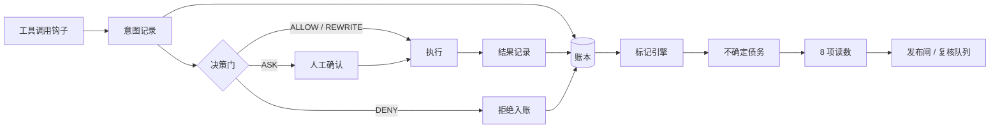

# 天序明衡 TemisGuard

> 让每一次运行都有据可查。

给智能体（Agent）的执行过程留下可被第三方独立复算的账，并在账本事实上标出证据缺口。

2026 华为云 openJiuwen 创新大赛参赛项目 · 规格版本 v2.7

---

## 1. 它解决什么问题

AI 编程智能体已经能自主改代码、跑命令、提交仓库。但一次运行结束后，有两类信息仍然说不清：

- **做过什么，凭什么做的**：依据散落在日志里，日志可被改写、可被清理，第三方无法确认记录是否被动过。
- **结论够不够扎实**：结论背后的证据缺了哪一环、缺了几处、累计欠了多少，没有计量口径。

TemisGuard 在智能体执行的关键节点采集事实，把事实固化成账，再在账上计算缺口。

## 2. 核心能力

| 能力 | 输入 | 输出 | 回答的问题 |
|---|---|---|---|
| Agent 行为可审计 | 工具调用前的意图、执行后的结果 | 只可追加的账本、内容指纹链、可独立复算的证据包 | 做了什么、依据是什么、结果是什么、有没有被改动过 |
| 决策不确定性标记 | 账本内事实、策略表声明 | 三类标记、传播结果、不确定债务 | 证据是否足够、缺口在哪里、累计欠了多少 |

两者互为依据：可审计提供事实，标记在事实之上计算缺口。缺少事实，标记没有挂载对象；缺少标记，事实无法判断是否足够。

判定与执行策略（决策门）是接入手段，作用是决定账本「依据」一栏写入什么内容，不构成独立能力。

## 3. 设计要点

**意图先于动作。** 工具调用前写入意图记录（依据、参数摘要、白名单版本），执行后追加结果记录。两条记录以内容指纹首尾相连。

**账本自包含。** append-only、逐行内容哈希、首尾成链、写入前脱敏。OpenTelemetry 只作 trace 弱引用；删掉链路日志后，账本仍可逐条复算。

**三类标记。**

| 标记 | 含义 |
|---|---|
| `NO_EVIDENCE` | 决策缺少支撑证据 |
| `SOURCE_CONFLICT` | 多个来源给出不一致的事实 |
| `SPEC_MISMATCH` | 实际参数与策略表声明不一致 |

标记按 high / mid / low 标注，沿依赖边向下游传播。原始等级不因跳数降低，衰减只作用于下游影响呈现。

**不确定债务。** 未消解的标记计入债务，权重取等级值：high 3、mid 2、low 1。每条债务关联一个决策、一种标记类型、一个权重、一个状态，以及消解时引用的证据。补证、统一来源、修正参数并重新过闸分别消解三类标记；消解只追加状态，原始条目保留。单次运行债务值达到策略表阈值时进入复核队列。

**决策门。** `ALLOW` / `ASK` / `DENY` / `REWRITE` 四种判定，ASK 超时对高危动作拒绝并标 `TIMEOUT`，低危可按配置放行。判定纯规则、不联网、不调用模型，P95 低于 50ms。

## 4. 运行链路



## 5. 仓库现状

| 项 | 状态 |
|---|---|
| 产品规格 | v2.7 已冻结，16 页 PDF |
| 后端代码 | 现有流水线沿用 ARS；B 已新增 `engine/v27/` 离线计算入口，输出标记、债务、8 项读数与 Skill 聚合 |
| 债务模块 | B 的 v2.7 投影按 high/mid/low 加权、消解只追加；C 的 `ledger/debt_tracker.py` 仍为旧 CU 模型，持久化接线待联调 |
| Studio UI | 当前 checkout 缺少 `ui/src`，v2.7 展示与接口接线待 D 实现 |
| 测试 | `tests/` 已覆盖旧 ARS 与 v2.7 计算；SDK 采集集成需另配环境验证 |
| 文档构建 | PRD PDF 与架构图均可由脚本重复生成 |

## 6. 口径迁移

仓库名与包名沿用早期名称 `assurance-ledger`，产品现名「天序明衡 TemisGuard」。规格与代码的差异集中在一处：

| 项 | v2.7 规格 | 当前代码 |
|---|---|---|
| 审计对象 | 每个关键决策的意图与结果 | 每条 claim 与证据包 |
| 核心读数 | 运行读数 8 项，含不确定债务 | B 离线入口已实现；现有流水线与 HTTP 接口仍为 ARS 五维评分 |
| 债务定义 | 三类标记按 high 3 / mid 2 / low 1 加权 | B 投影已实现；C 的持久化债务接口仍按 CU 计量 |
| 门禁依据 | 策略表 + 三类标记 | 规则编译 + ARS 阈值 |

迁移按 PRD §10 验收项推进，逐项把代码对齐到 v2.7。README、PRD、架构图、PPT 四份材料使用同一套口径。

## 7. 快速开始

### 后端

本地运行 B 的 v2.7 合成样例（无模型密钥、无网络调用）：

```bash
python scripts/b_v27_demo.py --output outputs/b_v27_demo/report.json
```

债务初始 6 条、权重 11；消解 3 条后剩余 3 条、权重 5，原始事件保留。接口和接入边界见 [B v2.7 契约](docs/api/B_V27_CONTRACT.md) 与 [本轮交接](docs/handoff/B_v27_R1_2026-11-11.md)。

```bash
python -m pip install -e ".[dev]"
```

跑一次真实运行（调用 DeepSeek，温度 0，读取 `fixtures/source/` 的行情快照，产出编译判定、日报、claim 与用量）：

```bash
# 需要 pandas 与 openai
pip install pandas openai
set DEEPSEEK_API_KEY=你的密钥
python scripts/run_daily_agent.py
```

输出写入 `fixtures/runs/`：`s0_compile.json`、`report.md`、`claims.json`、`meta.json`。

### 文档构建

```bash
# 重新生成 PRD v2.7 PDF（需 markdown、pypdf、reportlab，脚本内指定 Chrome 路径）
python build/prd/build_pdf.py

# 重新生成架构图 SVG 与 PNG
python build/design/gen_arch.py
```

### Studio UI

当前只有依赖清单，待 D 补齐 `ui/src` 后使用以下入口：

```bash
cd ui
npm install
npm run dev        # 本地开发
npm run build      # 产出 dist/
```

## 8. 目录结构

```text
docs/
  prd/          PRD v2.7（Markdown + PDF）
  design/       架构图 SVG / PNG
  ppt/          创意提交 PPT
  plan/         整改计划
  reviews/      评审记录
  reference/    大赛资料
  PROGRESS.md   进展记录（追加式）
src/assurance_ledger/
  core/         数据模型：claim / evidence / rule / ledger_entry / ars / cost
  schemas/      接口契约 C1–C13 校验
  rail/         S2 采集与成本
  engine/       规则编译、评分、改造方案
  ledger/       证据包、检查、账本、债务台账
scripts/        run_daily_agent / measure_ars / fetch_source / generate_sbom
tests/          旧 ARS 与 v2.7 计算回归
ui/             Studio 依赖清单，源码与 v2.7 展示待 D 接入
build/
  prd/          PRD PDF 构建
  design/       架构图构建
fixtures/       行情快照与真实运行产物
```

## 9. 文档入口

- [PRD v2.7](docs/prd/PRD-v2.7.md) — 定位、目标、功能、契约、指标、验收
- [PRD PDF](docs/prd/TemisGuard-PRD-v2.7.pdf)
- [架构图](docs/design/temisguard-architecture-v3.svg)
- [创意提交 PPT](docs/ppt/ThemisGuard_创意提交_v0.2.pptx)
- [进展记录](docs/PROGRESS.md)

## 10. 技术依赖

| 依赖 | 性质 |
|---|---|
| openJiuwen 0.1.20.post1 | 载体，唯一指定版本的硬依赖 |
| 工具调用前钩子 / Hook 分发器 | 接入点，决定能采集到的字段 |
| 追加写入数据库 | 账本介质，永久保留、不允许丢失 |
| OpenTelemetry | 弱引用，链路数据默认保留 7 天，可丢弃 |
| Python 3.10+ / Vue 3 | 运行环境 |

判定路径不依赖 OTel 导出器、不依赖网络、不依赖模型推理。

## 11. 许可证

Apache-2.0，见 [LICENSE](LICENSE)。
